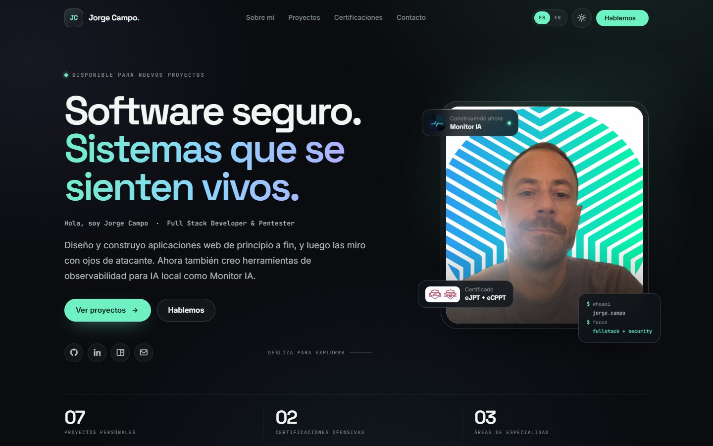

# Portfolio — Jorge Campo

> Software seguro. Sistemas que se sienten vivos.

Portfolio personal de **Jorge Campo**, Full Stack Developer & Pentester. Una web estática,
bilingüe y con tema claro/oscuro que reúne proyectos, certificaciones y el caso de estudio de
**Monitor IA**, mi panel de observabilidad para inferencia de IA local.

[Demo en vivo](https://yorchdev.netlify.app/) · [Monitor IA](https://github.com/Yorch82/monitor-ia) · [Blog](https://yorch82.github.io/) · [LinkedIn](https://www.linkedin.com/in/yorch82/)



## Características

- **Diseño one-page actual**: tipografía editorial, bento grid, glassmorphism sutil,
  gradientes, auroras y microinteracciones.
- **Tema oscuro y claro** con persistencia en `localStorage` y respeto por la preferencia
  del sistema.
- **Bilingüe ES/EN** sin frameworks: los textos se cargan desde JSON y se aplican con
  `data-i18n`, `data-i18n-aria` y `data-i18n-alt`.
- **Proyecto destacado Monitor IA**: caso de estudio con métricas reales, funcionalidades,
  stack, enlaces al repositorio y una recreación del dashboard en HTML/CSS/SVG.
- **Filtros de proyectos** por categoría (Web, Backend, Seguridad).
- **Certificaciones eJPT y eCPPT** con enlaces de verificación.
- **Totalmente responsive**: móvil, tablet y escritorio, con menú de navegación móvil.
- **Accesibilidad cuidada**: skip link, foco visible, etiquetas ARIA, textos alternativos,
  contraste validado y soporte para `prefers-reduced-motion`.
- **SEO listo**: metadatos, Open Graph, favicon y datos estructurados JSON-LD.
- **Sin build step**: HTML, CSS y JavaScript vanilla. Se despliega como sitio estático.

## Stack

| Área | Tecnología |
| --- | --- |
| Marcado | HTML5 semántico |
| Estilos | CSS3 con custom properties, Grid, Flexbox y `clamp()` |
| Interacción | JavaScript ES2020+ (vanilla) |
| Internacionalización | JSON + `fetch` + `data-*` |
| Tipografías | Space Grotesk, Inter y JetBrains Mono |
| Iconos | Devicon y Boxicons |
| Despliegue | Netlify / cualquier hosting estático |

No hay dependencias de npm ni proceso de compilación.

## Estructura principal

```text
Portfolio/
├── index.html              # Estructura, contenido y metadatos
├── css/
│   └── styles.css          # Sistema de diseño, componentes y responsive
├── js/
│   └── index.js            # Tema, i18n, filtros, menú y microinteracciones
├── languages/
│   ├── es.json             # Traducciones en español
│   └── en.json             # Traducciones en inglés
└── img/
    ├── preview.jpg         # Captura usada en este README
    ├── monitor-ia.png      # Icono del proyecto destacado
    ├── yo.png              # Retrato
    ├── ejpt.png            # Insignia eJPT
    └── ecppt.png           # Insignia eCPPT
```

## Ejecutar en local

Al ser un sitio estático no necesita instalación. Sirve la carpeta con cualquier servidor HTTP:

```bash
git clone https://github.com/Yorch82/Portfolio.git
cd Portfolio
python -m http.server 8080
```

Abre <http://localhost:8080>.

> Es importante usar un servidor HTTP. El selector de idioma carga los archivos de
> `languages/` mediante `fetch()`, por lo que abrir `index.html` directamente con `file://`
> hará que el cambio de idioma no funcione.

También puedes usar la extensión **Live Server** de VS Code o cualquier servidor estático.

## Personalización

### Textos e idiomas

Los textos viven en `languages/es.json` y `languages/en.json`. Cada elemento del HTML que
debe traducirse usa uno de estos atributos:

```html
<span data-i18n="hero.title1">Software seguro.</span>
<button data-i18n-aria="a11y.toggleTheme" aria-label="Cambiar tema">...</button>

```

Al añadir una clave nueva, inclúyela en ambos JSON para mantener la paridad.

### Colores y temas

Los tokens del tema oscuro están en `:root` y los del tema claro en
`[data-theme="light"]`, dentro de `css/styles.css`:

```css
:root {
  --accent: #6ef2c4;
  --bg: #07090c;
  /* ... */
}

[data-theme="light"] {
  --accent: #0a805e;
  --bg: #f4f5f1;
  /* ... */
}
```

### Proyectos

Las tarjetas de proyectos están en `index.html`, dentro de `#projects-grid`. Cada una usa
`data-category` (`web`, `backend` o `security`) para los filtros y una variable
`--card-accent` para su color de acento.

### Email de contacto

El email aparece en el bloque de contacto, en los enlaces `mailto:` y en la función de
copiar al portapapeles de `js/index.js`:

```text
jcampo82@proton.me
```

## Proyecto destacado: Monitor IA

**Monitor IA** es un dashboard en tiempo real para modelos que se ejecutan en tu propio
servidor. Mide tokens, ocupación de contexto, GPU/VRAM, temperatura, potencia y coste
energético, y añade seguridad y refrigeración del servidor.

- Backend: Python + FastAPI + SQLite + WebSocket.
- Frontend: React + Tailwind + Recharts.
- Extras: Docker, proxy OpenAI-compatible y app nativa SwiftUI para iOS.
- Repositorio: <https://github.com/Yorch82/monitor-ia>

En este portfolio se presenta como caso de estudio destacado, con un mockup del dashboard
construido en HTML/CSS/SVG para no depender de capturas externas.

## Despliegue

El proyecto está pensado para Netlify y funciona igual en Vercel, Cloudflare Pages o
cualquier hosting estático:

- **Build command**: vacío.
- **Publish directory**: `.` (raíz del repositorio).

Si tu proveedor está conectado a la rama `main`, cada push actualizará la web automáticamente.

## Accesibilidad y calidad

- Lighthouse: **100** en Accesibilidad, Buenas Prácticas y SEO, tanto en tema claro como oscuro.
- Un solo `<h1>` por página, jerarquía de encabezados consistente y enlaces internos válidos.
- Navegación completa por teclado, foco visible y cierre del menú móvil con `Escape`.
- Animaciones desactivadas o reducidas cuando el usuario activa `prefers-reduced-motion`.

## Contacto

- Email: [jcampo82@proton.me](mailto:jcampo82@proton.me)
- GitHub: [@Yorch82](https://github.com/Yorch82)
- LinkedIn: [yorch82](https://www.linkedin.com/in/yorch82/)
- Blog: [yorch82.github.io](https://yorch82.github.io/)

---

Diseñado y construido por **Jorge Campo**.
